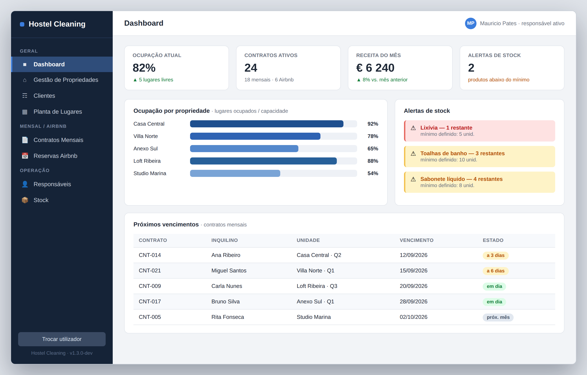
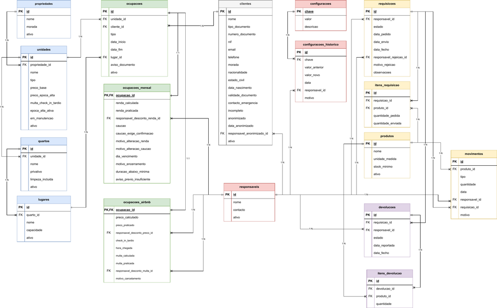

# Maurício Pates

### Software Development Student · Higher Technical Specialist in TPSI (EQF Level 5)

---

## About Me

- Currently in training at **IEFP Porto** – *Técnico Especialista em Tecnologias e Programação de Sistemas de Informação (TPSI)*
- 10 years of experience in the pharmaceutical sector (sales analysis & loss prevention), now transitioning into tech
- Currently learning **ETL with SQL Server**
- Porto, Portugal

---

## Tech Stack

      &nbsp;&nbsp;&nbsp;

      &nbsp;&nbsp;&nbsp;

      &nbsp;&nbsp;&nbsp;

      &nbsp;&nbsp;&nbsp;

      &nbsp;&nbsp;&nbsp;

      &nbsp;&nbsp;&nbsp;
      

      &nbsp;&nbsp;&nbsp;

      &nbsp;&nbsp;&nbsp;

      &nbsp;&nbsp;&nbsp;

      &nbsp;&nbsp;&nbsp;

      &nbsp;&nbsp;&nbsp;

---

## Featured Projects

* **[Hostel Gestão](https://github.com/Mauriciopates/hostel_gestao)**  
  *Hostel management system developed in Python with a relational database.*

  <table>
    <tr>
      <td align="center" width="50%">
        
         
        <b>Hostel System Preview</b>
      </td>
      <td align="center" width="50%">
        
         
        <b>Database Diagram</b>
      </td>
    </tr>
  </table>

---

## Get in Touch

